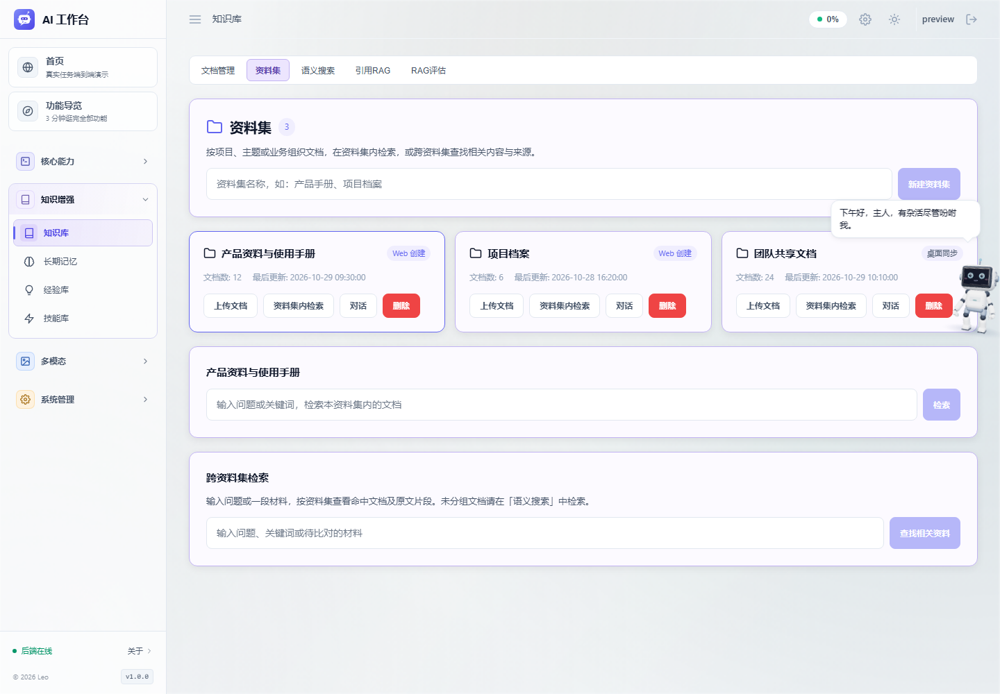
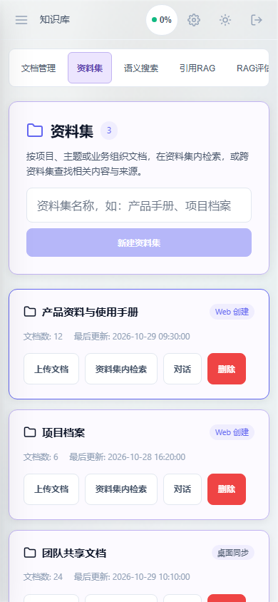
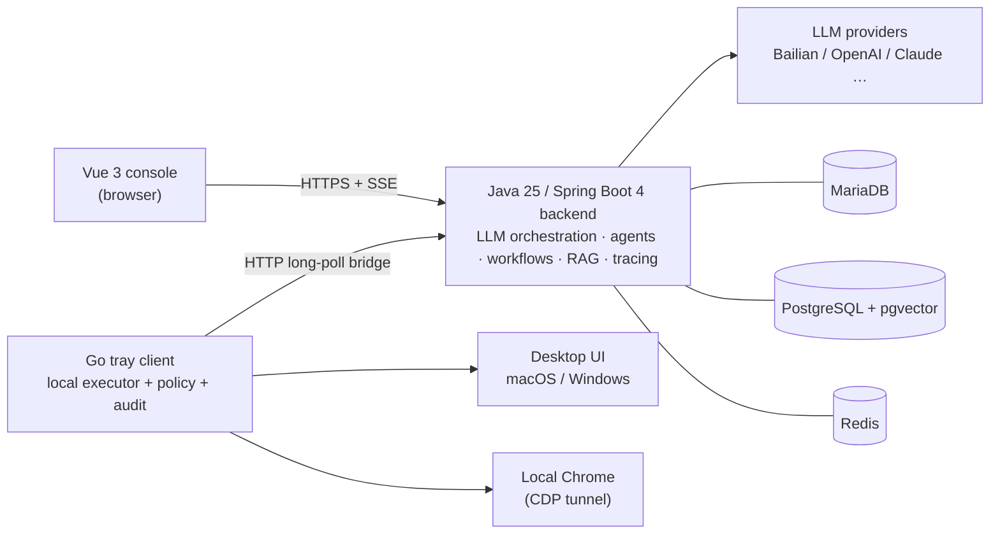

# AI Assistant — Full-Stack LLM Application Platform

[简体中文](README.zh-CN.md)

> **This repository is a product showcase.** It contains documentation, architecture overviews and UI previews only. The implementation (source code, binaries, configuration) is proprietary and is **not** distributed here.

AI Assistant is a self-hosted LLM application platform built on **Java 25 + Spring Boot 4 + Spring AI + Vue 3 + a native Go desktop client**. It covers autonomous agents, local machine & browser automation, visual workflow orchestration, retrieval-augmented generation, document/media production and multi-model routing.

The design principle in one sentence: **the cloud thinks, your machine acts.** The server orchestrates models, agents, workflows and knowledge; a tray-resident Go client on the user's own computer executes file, command, desktop and browser operations under tiered authorization — so the agent can actually *finish* tasks, not just describe how.

## What it does

| Area | Highlights |
|------|-----------|
| Autonomous agents (V2) | ReAct loop with checkpoints & resume, coding toolset, metacognition tools, context governance, human-in-the-loop guards, sub-task delegation with parallel UI lanes, self-evolving experience library |
| Local execution | Native Go tray client with 44 contracted capabilities, tiered authorization, two-level dangerous-command interception, local audit log, operation recording → reusable automations |
| Desktop automation | Accessibility-tree element actions on macOS (JXA/CoreGraphics) and Windows (UIA), vision/OCR supplement for self-drawn controls, filesystem-asserted save flows |
| Browser automation | Reuses the user's real Chrome session via CDP tunnel, human-like slider dragging, parallel isolated sub-agents, SSRF/redirect/irreversible-action guards |
| Workflows | Visual DAG editor with 43 node types, draft/publish versioning, persistent wait & approval nodes, full media production line (storyboard → compose → color grade → subtitles → voice clone → BGM → quality gate) |
| RAG | Parent-child chunking, table structuring, scanned-document OCR, hybrid retrieval (pgvector + BM25 + RRF + rerank), clickable citations, fidelity/relevance evaluation, NotebookLM-style podcast & study modes |
| Voice | Real-time ASR → LLM → TTS loop with VAD continuous conversation, echo suppression and barge-in |
| Ecosystem | MCP servers (static + dynamic + self-exposure), A2A agent-to-agent protocol, Feishu channel, web clipper extension |
| Engineering | Full-link tracing with token accounting and trace replay, cost dashboard, JWT multi-user auth, Flyway migrations, CI regression gate |

Full feature catalogue: [docs/FEATURES.md](docs/FEATURES.md) · Architecture: [docs/ARCHITECTURE.md](docs/ARCHITECTURE.md)

## System at a glance

## Tech stack

| Layer | Technology |
|-------|------------|
| LLM framework | Spring AI 2.0.1 |
| Backend | Spring Boot 4.0.0 on OpenJDK 25 (virtual threads) |
| Console | Vue 3 + Vite + Pinia, Vue Flow canvas |
| Local client | Go 1.24, tray-resident, native platform APIs |
| Business DB | MariaDB (MySQL protocol) |
| Vector store | PostgreSQL + pgvector |
| Cache / messaging | Redis |
| Browser automation | Playwright (Java) + CDP tunnel to local Chrome |
| Speech | DashScope realtime STT / TTS |
| i18n | English / Chinese, per-account preference |

## By the numbers

- 1,400+ commits on the private source repository
- 43 workflow node types, 44 contracted local-client capabilities, 30 console pages
- 2,600+ automated checks in the CI regression gate (backend regression subset, boot test in disposable DB containers, frontend tests & build, Node bridge tests, Windows Go client tests)
- 120+ Flyway schema migrations

## Notice

Copyright © 2026 the author. All rights reserved.

This repository publishes product documentation and UI previews for evaluation purposes. No source code, executable, model configuration or credential is included, and nothing here grants a license to the implementation. Screenshots show preview data, not real user data.
