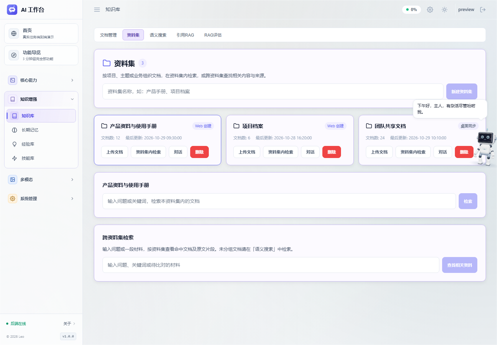
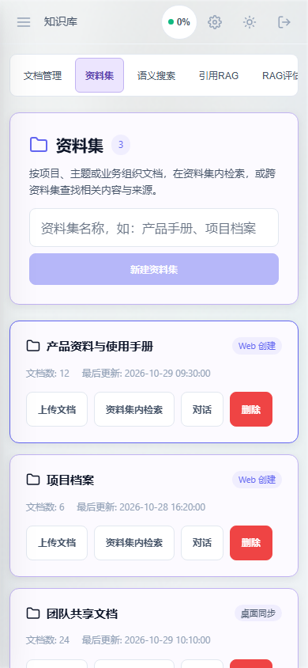
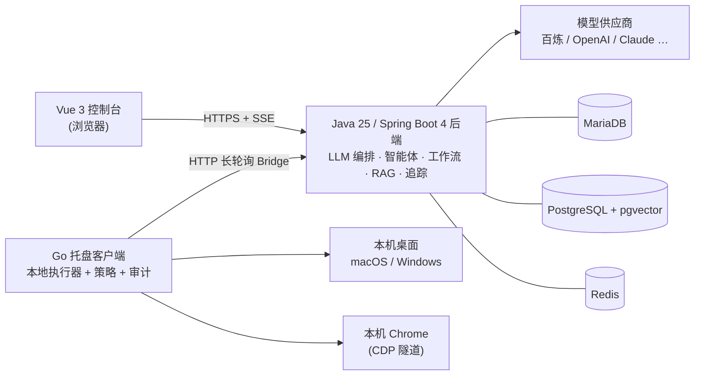

# AI Assistant — 大模型应用平台（展示库）

[English](README.md)

> **本仓库是产品展示库**：只包含文档、架构说明与界面预览图。实现代码、可执行文件与配置均为专有资产，**不在此仓库分发**。

AI Assistant 是基于 **Java 25 + Spring Boot 4 + Spring AI + Vue 3 + 原生 Go 客户端** 构建的全栈 LLM 应用平台，覆盖自主智能体、本机与浏览器自动化、可视化工作流、知识检索增强、文档/媒体生成与多模型路由。

设计原则一句话：**云端负责思考，本机负责动手。** 服务器编排模型、智能体、工作流与知识库；用户本机托盘常驻的 Go 客户端在分级授权下执行文件、命令、桌面与浏览器操作——让智能体真正"做完"任务，而不是"描述怎么做"。

## 能力概览

| 领域 | 亮点 |
|------|------|
| 自主智能体（V2） | ReAct 闭环 + 检查点续跑、编码工具集、元认知工具、上下文治理、人机协同双层防护、子任务委派并行泳道、经验自进化 |
| 本地执行 | 原生 Go 托盘客户端，44 条跨端契约能力，分级授权、危险命令两级拦截、本地审计日志、录操作蒸馏为可复用自动化 |
| 桌面自动化 | macOS（JXA/CoreGraphics）与 Windows（UIA）无障碍树元素操作，视觉/OCR 补树治自绘控件，保存动作内置文件系统落盘断言 |
| 浏览器自动化 | 复用本机 Chrome 真实登录态（CDP 隧道），滑块拟人拖拽，并行隔离子代理，SSRF/重定向/不可撤销动作安全闸 |
| 工作流 | Vue Flow 可视化 DAG，43 种节点，草稿/发布版本隔离，持久化等待与人工审批节点，完整媒体生产线（分镜→合成→调色→字幕→声音克隆→配乐→质检） |
| 知识检索 | 父子切块、表格结构化、扫描件 OCR，混合检索（pgvector + BM25 + RRF + 重排），可点击引用溯源，忠实度/相关性评测，NotebookLM 式播客与学习模式 |
| 语音 | ASR → LLM → TTS 实时闭环，VAD 连续对话、回声抑制、Barge-in 打断 |
| 生态 | MCP 服务器（静态 + 动态 + 自身对外暴露）、A2A 智能体互联、飞书通道、网页剪藏扩展 |
| 工程基建 | 全链路 Span 追踪与 Token 记账、Trace 回放、成本仪表盘、JWT 多用户、Flyway 迁移、CI 回归门禁 |

完整功能清单：[docs/FEATURES.md](docs/FEATURES.md) · 架构说明：[docs/ARCHITECTURE.md](docs/ARCHITECTURE.md)

## 系统一览

## 技术栈

| 层次 | 技术 |
|------|------|
| LLM 框架 | Spring AI 2.0.1 |
| 后端 | Spring Boot 4.0.0 / OpenJDK 25（虚拟线程） |
| 控制台 | Vue 3 + Vite + Pinia，Vue Flow 画布 |
| 本地客户端 | Go 1.24，托盘常驻，平台原生接口 |
| 业务库 | MariaDB（MySQL 协议） |
| 向量库 | PostgreSQL + pgvector |
| 缓存/消息 | Redis |
| 浏览器自动化 | Playwright（Java）+ 本机 Chrome CDP 隧道 |
| 语音 | DashScope 实时 STT / TTS |
| 国际化 | 中 / 英，按账号偏好同步 |

## 数字一览

- 私有源码库 1,400+ 次提交
- 43 种工作流节点、44 条客户端契约能力、30 个控制台页面
- CI 回归门禁 2,600+ 条自动化检查（后端回归子集、一次性数据库容器启动测试、前端测试与构建、Node 桥测试、Windows Go 客户端测试）
- 120+ 条 Flyway Schema 迁移

## 声明

版权所有 © 2026 作者，保留所有权利。

本仓库为评估目的发布产品文档与界面预览，不含源代码、可执行文件、模型配置或凭据，不构成对实现的任何许可。截图均为预览数据，非真实用户数据。
