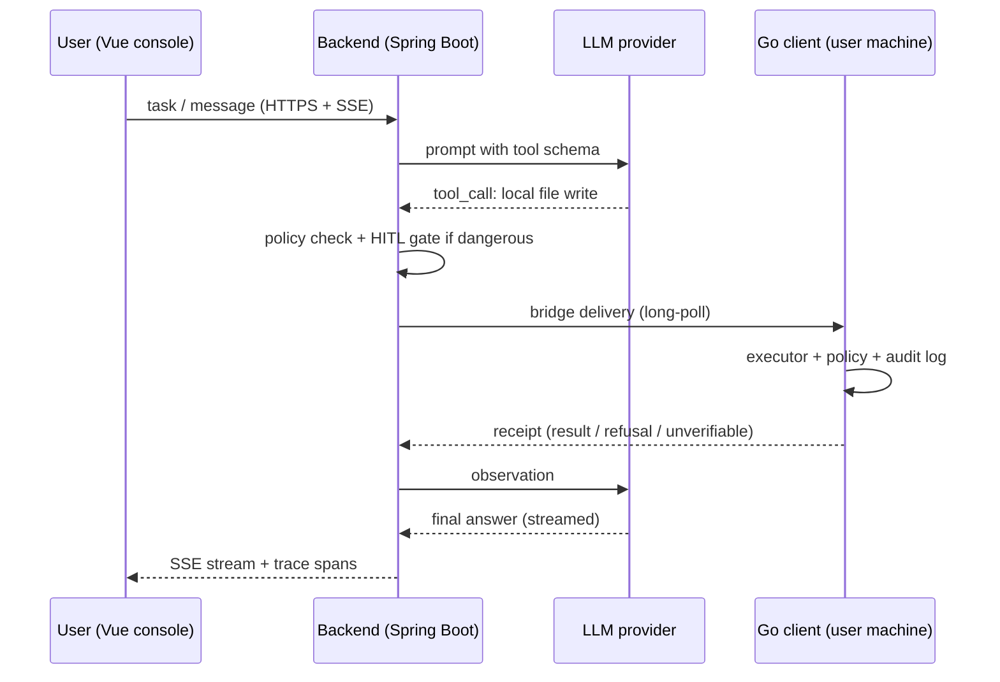
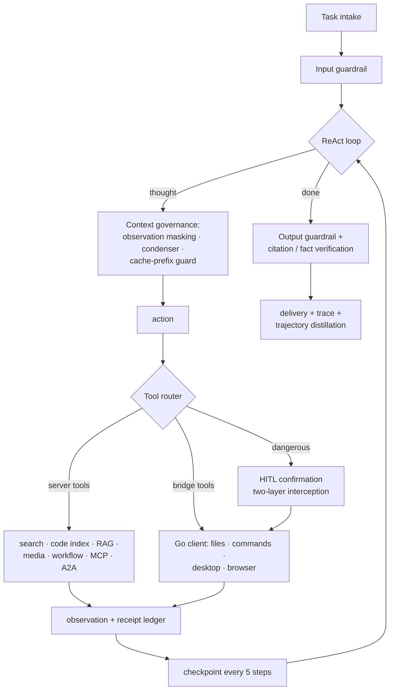
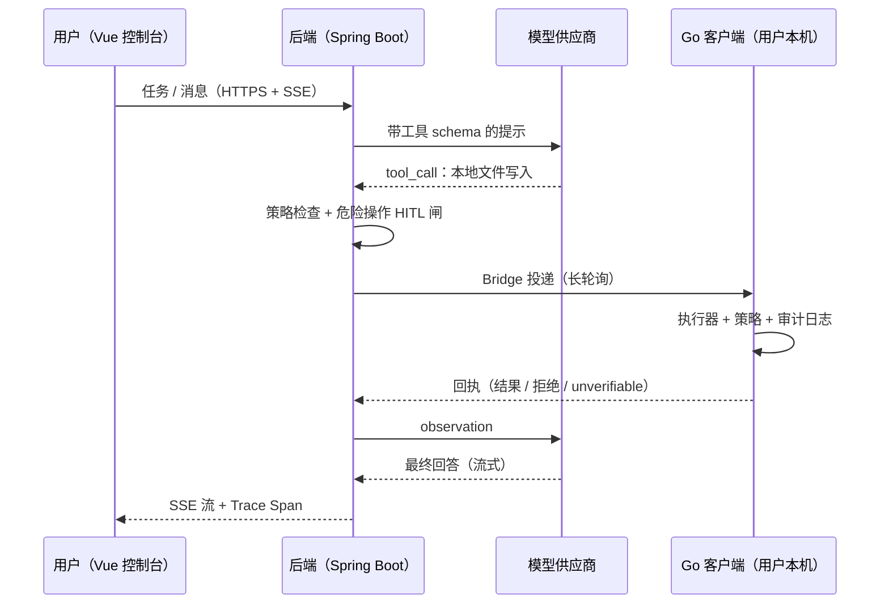
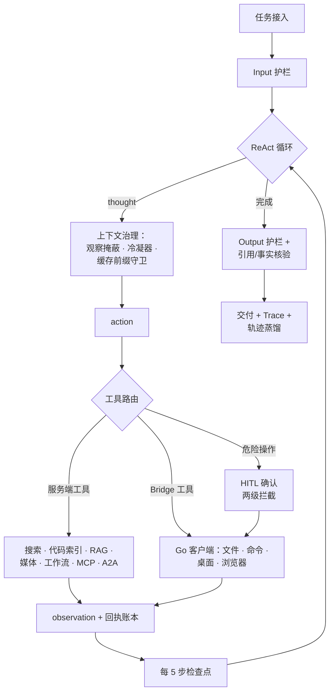
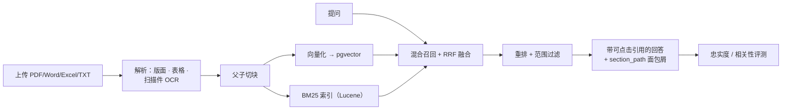

# Architecture Overview / 架构说明

Documentation only — the implementation is proprietary and not distributed in this repository.
（仅文档；实现为专有资产，不在本仓库分发。）

---

## English

### Components

| Component | Role | Technology |
|-----------|------|------------|
| `ai-assistant` | Cloud brain: LLM orchestration, autonomous agents, workflow engine, RAG, tool routing, tracing | Spring Boot 4 + Spring AI, JDK 25 (virtual threads) |
| `ai-assistant-web` | Console: observe agent execution, assign tasks, manage workflows / knowledge / experience | Vue 3 + Vite + Pinia, Vue Flow |
| `ai-assistant-client` | Local hands: tray-resident native program executing file / command / desktop / browser operations under tiered authorization | Go + platform-native APIs |
| `ai-assistant-clipper` (optional) | Clip article body / selection / link summary into the knowledge base | Chromium extension (Manifest V3) |

### Execution topology

The backend never touches the user's machine directly. All local capability is reached through a **bridge**: the Go client long-polls the backend over HTTP, pulls pending tool requests, executes them inside its local policy engine, and returns receipts. This keeps inbound connections unnecessary on the client side and makes every local action auditable.



### Autonomous agent loop



Key properties:

- **Recovery is a first-class path.** Checkpoints persist loop state; reconnect, terminal replay and resume are three distinct branches, not an afterthought.
- **The model's word is not evidence.** Receipts, citation verification and fact-forcing reconcile self-reports against what actually happened on disk or in the browser.
- **Context is a budget, not a dump.** Observation masking and condensation keep long tasks inside both the context window and the cost ceiling.

### Workflow engine

- Visual DAG (Vue Flow) edited as drafts; triggers and open APIs run **published snapshots**, so editing never disturbs a live definition.
- 43 node executors, including persistent `WAIT`, `POLL`, `APPROVAL`, and an `AGENT` node that delegates open-ended steps to the autonomous agent loop above.
- Runs persist an execution snapshot: historical canvases, waiting interactions and answers restore from their own run, never from the current draft.

### RAG pipeline

```mermaid
flowchart LR
    UP[Upload PDF/Word/Excel/TXT] --> PA[Parse: layout · tables ·<br/>scanned-page OCR]
    PA --> CH[Parent-child chunking]
    CH --> EM[Embed → pgvector]
    CH --> BM[BM25 index (Lucene)]
    Q[Question] --> HY[Hybrid recall + RRF fusion]
    EM --> HY
    BM --> HY
    HY --> RR[Rerank + scope filter]
    RR --> AN[Answer with clickable citations<br/>+ section-path breadcrumbs]
    AN --> EV[Fidelity / relevance evaluation]
```

### Security model

- Stateless JWT auth, slider captcha, multi-user isolation; file and screenshot access verifies ownership and real paths.
- Local client authorization is tiered (`system` / `project`) with whitelist writes; dangerous commands face two-level interception, and remembered approvals are scoped and revocable.
- Credentials live in an encrypted vault and are resolved only at the execution boundary (`{{cred:...}}`); they never travel into prompts or logs.
- Guardrails on both input and output; unknown or uncertain conditions fail closed.
- Browser automation carries URL / SSRF / redirect-chain guards and an irreversible-action gate.

### Data & observability

- MariaDB for business state (120+ Flyway migrations), PostgreSQL + pgvector for vectors, Redis for cache/messaging.
- Full-link spans (LLM calls, tool calls, voice STT/TTS) with token accounting roll-up, trace replay and a cost dashboard.
- CI regression gate on PR and main push: backend regression subset, application boot test inside disposable database containers, frontend tests & build, Node bridge tests, Windows Go client tests.

---

## 中文

### 组件

| 组件 | 角色 | 技术 |
|------|------|------|
| `ai-assistant` | 云端大脑：LLM 编排、自主智能体、工作流引擎、RAG、工具路由、追踪 | Spring Boot 4 + Spring AI，JDK 25（虚拟线程） |
| `ai-assistant-web` | 控制台：观察智能体执行、下达任务、管理工作流/知识库/经验 | Vue 3 + Vite + Pinia，Vue Flow |
| `ai-assistant-client` | 本地手脚：托盘常驻原生程序，分级授权下执行文件/命令/桌面/浏览器操作 | Go + 平台原生接口 |
| `ai-assistant-clipper`（可选） | 网页正文/选区/链接摘要剪藏入知识库 | Chromium 扩展（Manifest V3） |

### 执行拓扑

后端从不直连用户机器。所有本地能力经由 **Bridge** 触达：Go 客户端 HTTP 长轮询拉取待执行工具请求，在本地策略引擎内执行并回传回执。客户端无需开放入站连接，且每条本地操作均可审计。



### 自主智能体循环



关键性质：

- **恢复是一等路径。** 检查点持久化循环状态；断连重挂载、终态补发、未完成续跑是三个独立分支，而非事后补丁。
- **模型的自报不是证据。** 回执账本、引用核验与事实强制把自报与磁盘/浏览器上真实发生的事对账。
- **上下文是预算不是垃圾场。** 观察掩蔽与冷凝让长任务同时守在上下文窗口与成本顶之内。

### 工作流引擎

- Vue Flow 可视化 DAG 以草稿编辑；触发器与开放 API 运行**发布快照**，编辑永不扰动线上定义。
- 43 种节点执行器，含持久化 `WAIT`、`POLL`、`APPROVAL`，以及把开放步骤委派给自主智能体循环的 `AGENT` 节点。
- 运行持久化执行快照：历史画布、等待中的交互与答案从当次运行还原，绝不用当前草稿替代。

### RAG 管道



### 安全模型

- JWT 无状态鉴权 + 滑动验证 + 多用户隔离；文件与截图访问校验所有者与真实路径。
- 本地客户端分级授权（system / project），写入限白名单；危险命令两级拦截，记住的授权按作用域限制且可撤销。
- 凭据加密入库，仅在执行边界以 `{{cred:...}}` 解析；不进入提示词与日志。
- 输入输出双向护栏；未知或不确定情形 fail-closed。
- 浏览器自动化带 URL / SSRF / 重定向链守卫与不可撤销动作闸。

### 数据与可观测性

- MariaDB 承载业务状态（120+ 条 Flyway 迁移），PostgreSQL + pgvector 承载向量，Redis 承载缓存/消息。
- 全链路 Span（LLM 调用、工具调用、语音 STT/TTS）+ Token 记账归集 + Trace 回放 + 成本仪表盘。
- PR 与 main 推送触发 CI 回归门禁：后端回归子集、一次性数据库容器内启动测试、前端测试与构建、Node 桥测试、Windows Go 客户端测试。
